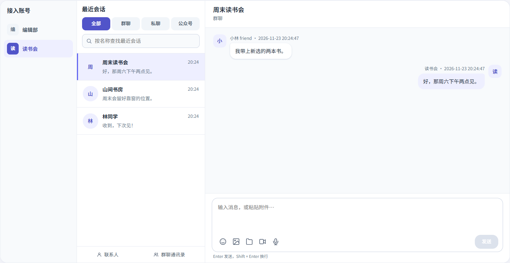

# Documentation

Start with [AGETNS-DEV.md](../AGETNS-DEV.md) for shared AI development rules and
[CONTRIBUTING.md](../CONTRIBUTING.md) for environment setup. Each topic below has
one maintained reference; update it when behavior changes.

## Development

| Topic | Reference |
| --- | --- |
| Module ownership, import direction, Kitesurf and Hindsight | [Architecture and shared dependencies](architecture.md) |
| Plugin package, manifest, execution, settings, schedules, recall and administration UI | [Plugin development](plugin-development.md) |
| Installable example | [hello_plugin](plugin-template/hello_plugin) |
| UI components, tokens, copy, interaction and acceptance | [UI guidelines](ui/soft-ui-guidelines.md) |
| Focused checks, isolation, CI and test maintenance | [Testing](../tests/README.md) |

The signed-in documentation center reads `bridge-api.md` and
`plugin-development.md` and builds the example ZIP from `plugin-template/hello_plugin`.
Keep these files and their route references in sync.

## API and integrations

| Topic | Reference |
| --- | --- |
| External applications: signing, messages, media, resources and webhooks | [Open API / bridge](bridge-api.md) |
| Supplier-order system integration | [Supplier-order integration](open-api-supplier-order-integration.md) |
| Existing tool API consumer | [Tool API for OSM](tool_api_for_osm.md) |
| WeCom customer operations | [Customer operations API](workwechat_customer_operations_api.md) |

Consumer-specific guides explain their own configuration; the bridge guide owns
the general Open API contract. Do not copy another business system into this repo.

## Message inbox

Open **消息** and select a connected account to see its recent conversations. Filter by conversation type or search by name within the recent list. On phones, open a conversation to chat and use the back arrow to return to the list.

## Channels and operations

| Topic | Reference |
| --- | --- |
| Local images, videos, voice/audio and safe cleanup | [Media library](media-library.md) |
| WeBridge connection, directory synchronization and friend checks | [WeBridge](wechat_webridge_provider.md) |
| Native group content moderation and removal results | [Group moderation](group-moderation.md) |
| Centralized AI connections, encrypted keys and model selection | [AI providers](ai-providers.md) |
| Quoted images/videos and independent visual model settings | [AI vision](ai-vision.md) |
| Native text-to-image and exact quoted-image editing | [AI drawing](ai-drawing.md) |
| iPad channel and login proxy setup | [iPad provider](wechat_ipad_provider.md) |
| WeCom provider connection | [WeCom provider](workwechat_provider.md) |
| Windows automation transport | [WinAuto provider](wechat_winauto_provider.md) |
| Installation, database upgrades and operations | [Deployment](deployment.md) |
| Supported import into an existing tenant | [Data import](legacy-import.md) |

## Documentation maintenance

Keep stable behavior, required examples and source pointers in the appropriate
guide. Write new public documentation in English, retaining application labels
where needed. Use fictional data and omit machine-specific deployment details.

Plans, review diaries, raw reports and process screenshots stay in ignored local
directories. A tracked file remains tracked after an ignore rule is added, and
removing it from the current tree does not erase previous commits. Public delivery
must also follow the history review rules in the shared development contract.

Keep only intentional, sanitized and referenced product illustrations in
`docs/images/`. Do not maintain historical acceptance logs in normative guides.
